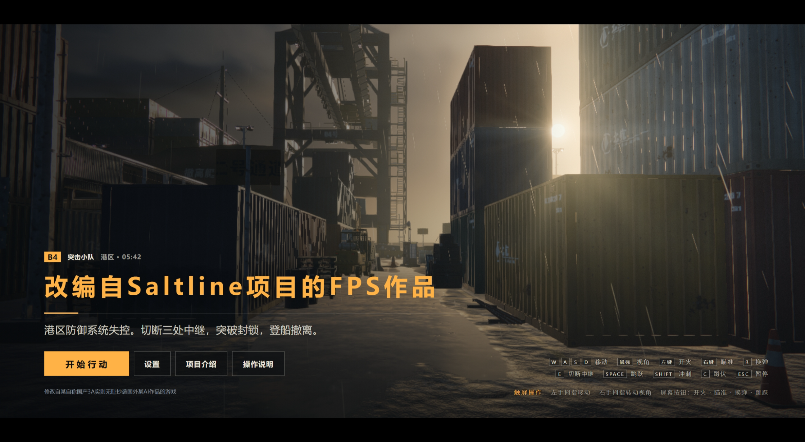
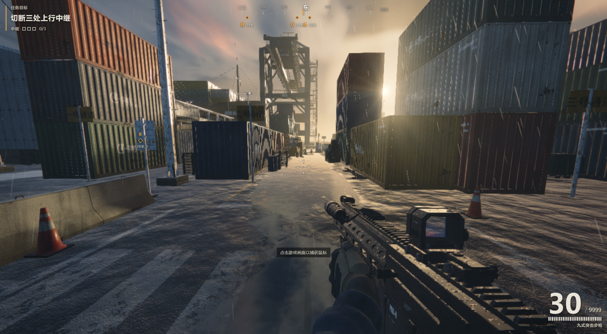
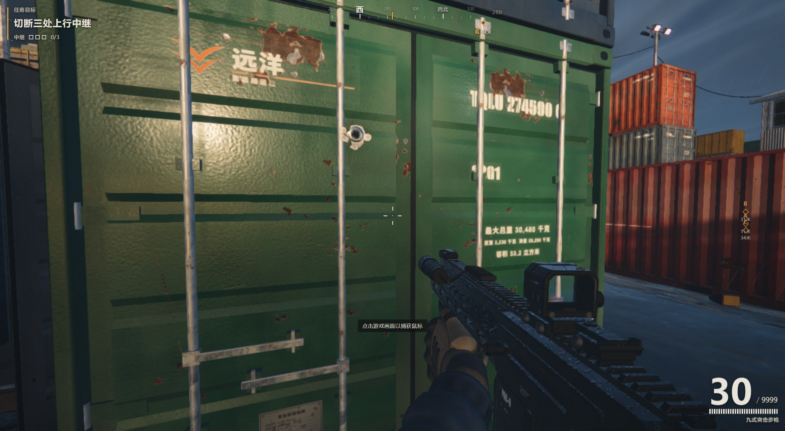
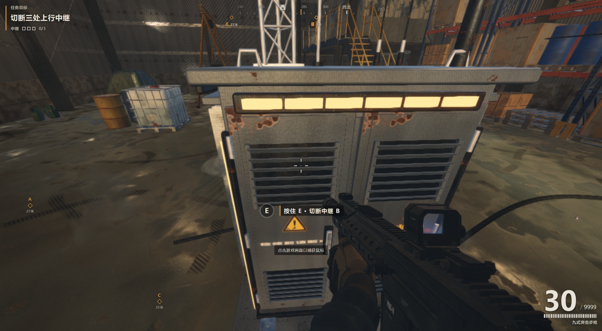
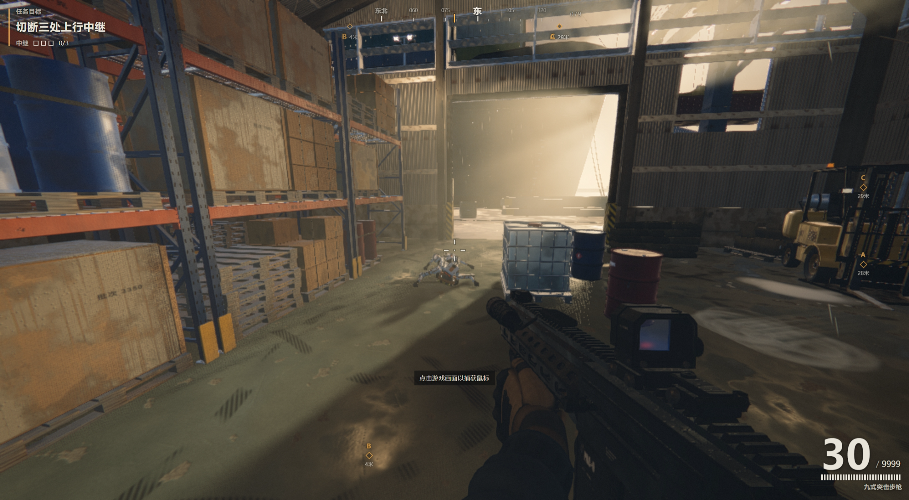
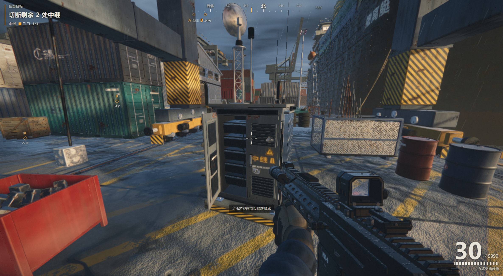

# Saltline-CN

网站部署：

[标准版](https://molunsi.github.io/Saltline-CN/Saltline-CN.html)

[无敌版](https://molunsi.github.io/Saltline-CN/Saltline-CN-无敌版.html)

## 主要介绍

一个间接基于Saltline项目制作的中文FPS游戏，除汉化与无敌版的修改外，严格忠于原版

直接改编于[Saltline：单文件 3D 射击游戏（中文版本）](https://github.com/Megasu/jimao-3a-game)，不过由于该修改者有虚假宣传嫌疑并且署已自己之名，于是有此二次修改版。

该游戏的原始案例为 **Saltline** ，收录于署名 **Felix Rieseberg** 的 [Three Games 案例合集](https://claude.ai/artifact/MXxb36zKgN261ckbGhmNin)。合集页面介绍这些游戏使用 Claude Fable 5.2 制作。原始案例**未标明协议** ，依照版权法，其意义为 **”保留所有权利“** 。因此，本改编版本以及[Saltline：单文件 3D 射击游戏（中文版本）](https://github.com/Megasu/jimao-3a-game)并不视作得到原作者授权。如果确认侵权，本项目将会立即删除，但将不会赔偿由本项目给任何人带来的经济损失。

此外，该游戏的无敌版由我个人开发，无敌版所遵从的协议依旧是Unlicence。

尽管我已确定开源协议为Unlicence，个人依然**建议**请勿商用。此处商用的定义为贩卖该游戏以及其衍生、修改作品或插入广告直接盈利，或者投放到平台上以广告分红等方式间接盈利。仅提供个人建议。

建议本项目仅用于无偿教学与无偿学习用途，或仅个人使用（不加以传播）。

## 截图展示

[@Github主页](https://github.com/MOLUnsi)

[@哔哩哔哩主页](https://space.bilibili.com/3546714656999647)
